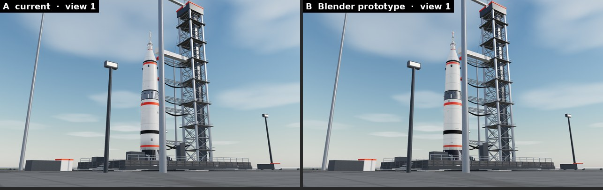
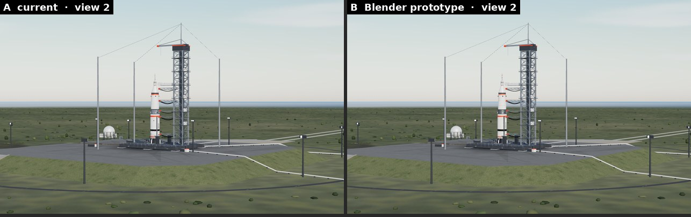
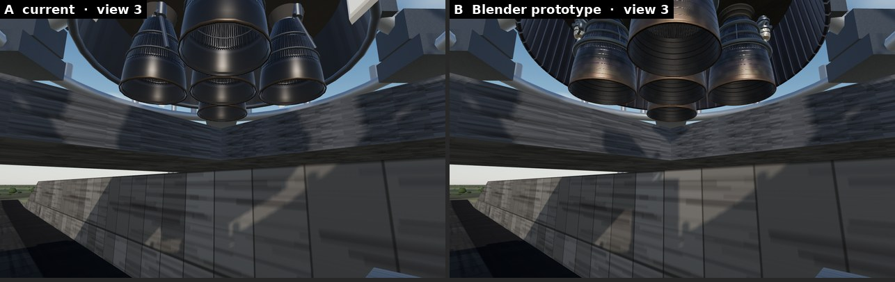
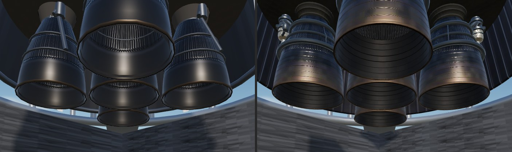
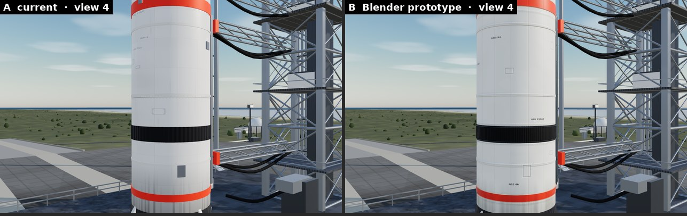
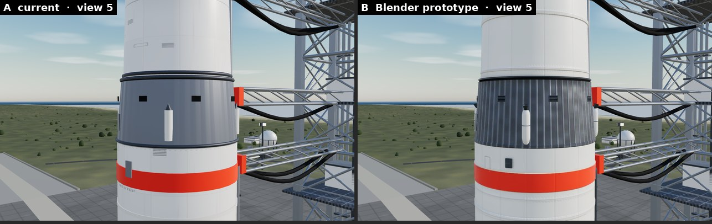
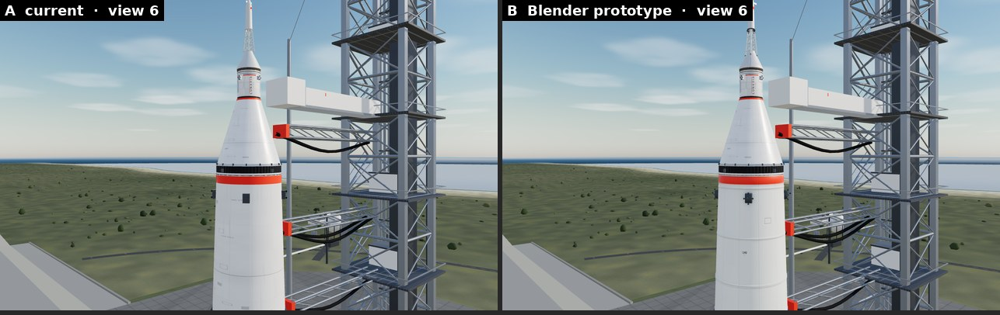
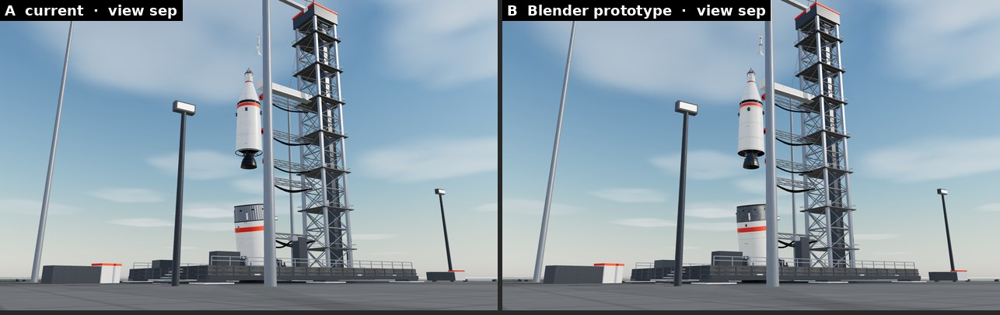
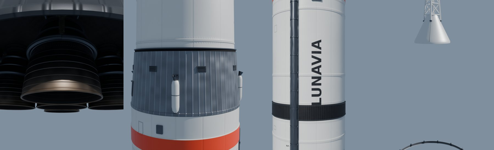

# LV-001 Blender prototype — in-game comparison

Branch `claude/lv001-3d-prototype` (from e9573fc, itself on `claude/nasa-visual-upgrade` 0a191f2,
BUILD 1317851). A **visual prototype only**: the game still uses `RocketModel.jsx`; the prototype
is reachable only at the development route `/dev/lv001` and is absent from production builds.
Asset sources, hierarchy, materials and the integration interface: [`art/lv001/README.md`](../../art/lv001/README.md).

## Method

* `/dev/lv001?model=a|b&view=1..6` renders the pad in LUNAVIA's own renderer with the launch
  film's pad set-up: the same Sun (2.4, `#fff2e2`, from (10, 8, 8), 1536² shadow map), ambient 0.2,
  hemisphere 0.25, day-sky PMREM reflections at 0.85, ACES, exposure 1, the true-scale environment
  composited behind, `LaunchComplex`, the vehicle at `BASE_Y` 0.16 and `ROCKET_SCALE` 0.6, its
  meshes casting shadows. Only the vehicle differs. A = `RocketModel` (BUILD 1317851's rocket),
  B = the GLB + LUNAVIA's runtime `PayloadSection` (the payload is not remodelled).
* Views 2 and 3 are the launch film's own pad shots (`wide`, `engines`); 1, 4, 5, 6 are fixed
  cameras on the full vehicle from the ground, the first-stage body, the interstage, the upper stage
  and payload.
* Captures: Chromium + SwiftShader (software WebGL), 1280×800, DPR 1, read from the WebGL canvas.
  Not an iPhone; frame times below are software-rendering numbers, useful only as A-vs-B ratios.

## The six views (left A, right B)

| View | Images | Verdict |
| --- | --- | --- |
| 1 Full vehicle, ground level |  | **No visible difference** at this distance. |
| 2 Rocket and tower (film `wide`) |  | **No visible difference.** |
| 3 Engine section (film `engines`) |   | **Clearly better**: baked tube walls, F-1 extension shingles, foil-wrapped turbopumps, gas generators, manifolds and ducts, detailed bell interiors. A's bells are cleaner and shinier; B reads as engineered hardware. |
| 4 First-stage body |  | **About equal.** Weld lands, panel seams, stencils and AO are present but subtle; A's painted seams read just as well. |
| 5 Interstage |  | **Better**: real stringers, louvred vents, retro-motor fairings and nozzles, the frangible joint. |
| 6 Upper stage and payload |  | **About equal** (the payload is the same runtime component in both). |

Separation interface: stage 1 at `sep` 0.35 and the LES at `les` 0.6 through the same `ctrlRef`
— identical in A and B: 

Blender diagnostic renders (geometry / bake checks only, not evidence): 

## Measurements

Vehicle only (`?solo=1`: no complex, no environment; both include the runtime payload):

| | A current | B prototype |
| --- | --- | --- |
| Draw calls, view 1 / view 3 | 105 / 65 | 78 / 26 |
| Triangles, view 1 / view 3 | 68,084 / 48,796 | 113,316 / 59,740 |
| Shader programs (view 1) | 52 | 32 |
| Geometry memory | 2.52 MB | 3.78 MB |
| Texture GPU memory, the vehicle's own set | 22.6 MB (canvas textures, RGBA8 + mips) | **8.7 MB** compressed (KTX2 → ASTC / ETC2 on iPhone, gltf-transform estimate; 49 MB if it were RGBA8) |
| Asset download | 0 (procedural, built at start-up) | 2.60 MB GLB (KTX2 + meshopt); 1.44 MB as WebP + meshopt |
| Load (solo): fetch / parse + transcode | — | 139–165 ms / 585–703 ms |
| First frame after mount (solo) | 1.4–2.0 s | 3.1–4.0 s |
| Frame time, SwiftShader, view 1 / 3 | 110 / 176 ms | 206 / 214 ms |

Full pad scene (complex + environment): A 133 calls / 128 k triangles, B 106 calls / 173 k
triangles (view 1); SwiftShader frame 414 vs 494 ms (view 1), 521 vs 604 ms (view 3). With the full
scene loading at the same time, B's parse + Basis transcode took ~8.7 s in this CPU-only browser.

Asset itself (Blender): 102,348 triangles, 34 mesh objects, 56 mesh/material primitives,
17 materials, 31 textures.

## Production bundle

`craco build` on this branch: no prototype code, GLB, meshopt / KTX2 loader or Basis transcoder in
`build/` — the only match is App.js's own source text inside `main.*.js.map` (as for the existing
`/dev/eva` route). `claude/ios-release` is untouched.

## Conclusion

**Limited improvement.** The prototype is a proper, editable Blender asset with separate stage /
engine / LES objects, real PBR maps, Cycles-baked tube walls and AO, compressed textures, and the
same separation interface — and it is clearly better in the engine section and the interstage.
But at the distances the game mostly shows the vehicle (views 1, 2) it is indistinguishable from
the current LV-001, and the stage bodies and the upper stage are only on par. It costs about 1.7×
the triangles and a slower first frame. It does not meet "substantially better in all six views".
